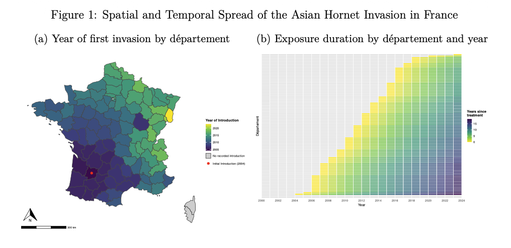
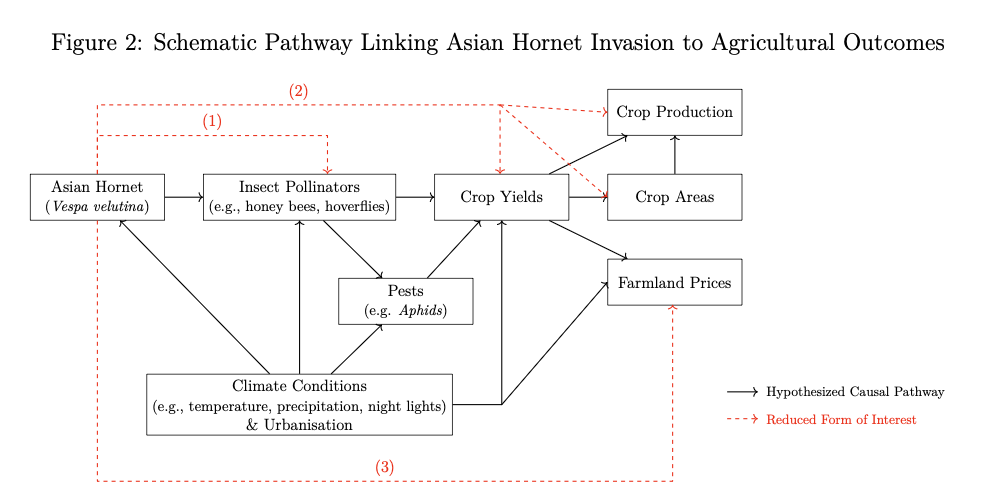
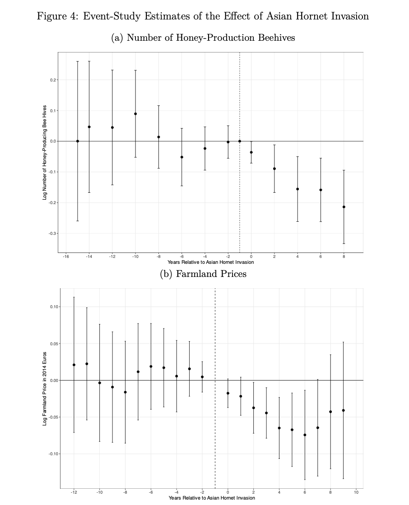

## Research Interests

My research focuses on identifying and quantifying the economic value of ecosystem services and understanding how economic activities impact ecological systems. I am particularly interested in designing policies that can better manage this bidirectional relationship.

## Working Papers

### Understanding and Addressing Temperature Impacts on Mortality

Marshall Burke, Andrew Wilson, Ziqian Xia, **Léon Beaufils**, Tumenkhusel Avirmed, Jonas Wallstein, Tina Bardot, Mariana Martins, Patrick Behrer, Christopher W. Callahan, Marissa Childs, June Choi, Karina French, Carlos F. Gould, Guojun He, Sam Heft-Neal, Renzhi Jing, Minghao Qiu, Lisa Rennels, and Emma Southworth

*Under review*

A large literature documents how ambient temperature affects human mortality. We compile longitudinal sub-national data from 115 countries and territories representing nearly 500M deaths, and use the data to revisit and synthesize key findings from this literature. We confirm that ambient temperature is among the largest external threats to human health, with heat and cold responsible for 3–15% of deaths across all countries in our sample, putting it among the top causes of death in many countries. In most contexts we consider, including low- and middle-income tropical countries, cold kills more than heat, though the temperature of minimum risk rises with age, making younger individuals generally more vulnerable to heat and older individuals more vulnerable to cold. We find evidence for adaptation to the local climate, with hotter places experiencing somewhat lower risk on hot days but often higher aggregate heat-related mortality due to more frequent exposure. Within countries, higher income is not associated with uniformly lower vulnerability to ambient temperature. Guided by these results, we systematically review the academic literature studying interventions that can moderate the impact of heat and cold on health, limiting our search to studies that resolve a plausibly causal relationship. Consolidating results across 52 studies, we find that many proposed and implemented interventions lack empirical support and do not target temperature exposures that generate the highest health burden. Further, some of the most beneficial interventions for reducing the health impacts of cold or heat have little explicit to do with the climate.

{.paper-figure .lightbox fig-alt="Three-panel figure: a world map of study coverage, regional temperature–mortality response curves, and a bar chart of the share of deaths attributable to heat and cold by country."}

<!-- WORK IN PROGRESS - Uncomment when paper is ready

### The Economic Cost of Pollinator Loss
#### Evidence from an Invasive Species

::: {.grid}

::: {.g-col-7}
**Solo-authored**

*Working Paper*

Insect pollinators are in global decline due to anthropogenic pressures, despite continued growth in the production of pollination-dependent crops. This divergence poses risks to agricultural productivity and food security, yet the economic value of pollination services remains poorly identified. As a result, policymakers face challenges in incorporating pollinators into cost-benefit analyses for conservation efforts and in addressing the negative externalities that contribute to their decline. This paper provides causal estimates of the effects of pollinator loss by exploiting quasi-exogenous variation in pollination supply from the staggered biological invasion of the Asian hornet (*Vespa velutina*) – a predator of insect pollinators – across France. Using a difference-in-differences design, I find that hornet invasion reduces managed beehive counts by 11.4%, oilseed rape yields by 5.2%, and average farmland prices by 4.3%. These results underscore the high economic value of insect pollinators for agriculture and illustrate how ecosystem health can shape economic outcomes.

[Draft](papers/pollinator-loss-draft.pdf) | [Slides](papers/pollinator-loss-slides.pdf) | [Code](https://github.com/yourusername/pollinator-study)
:::

::: {.g-col-5}

  

    <button type="button" data-bs-target="#carouselPollinators" data-bs-slide-to="0" class="active" aria-current="true" aria-label="Slide 1"></button>
    <button type="button" data-bs-target="#carouselPollinators" data-bs-slide-to="1" aria-label="Slide 2"></button>
    <button type="button" data-bs-target="#carouselPollinators" data-bs-slide-to="2" aria-label="Slide 3"></button>
  

  

    

      
      

        
Figure 1: Impact on beehive counts

      

    

    

      
      

        
Figure 2: Hornet invasion timeline

      

    

    

      
      

        
Figure 3: Event study results

      

    

  

  <button class="carousel-control-prev" type="button" data-bs-target="#carouselPollinators" data-bs-slide="prev">
    
    Previous
  </button>
  <button class="carousel-control-next" type="button" data-bs-target="#carouselPollinators" data-bs-slide="next">
    
    Next
  </button>

:::

:::

-->