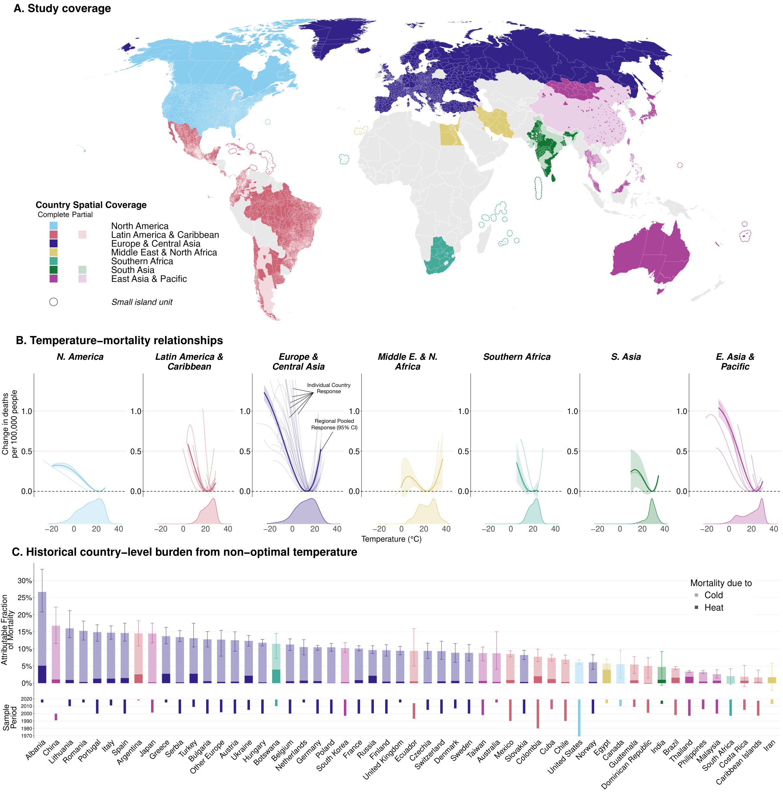
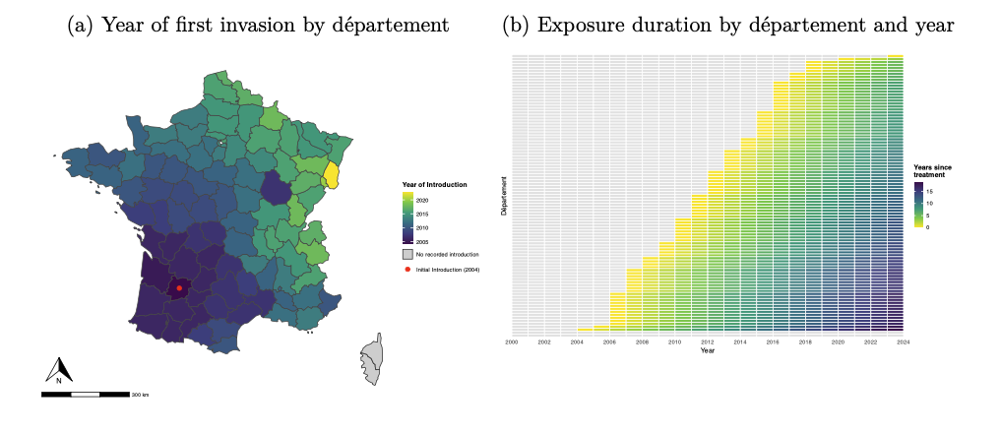
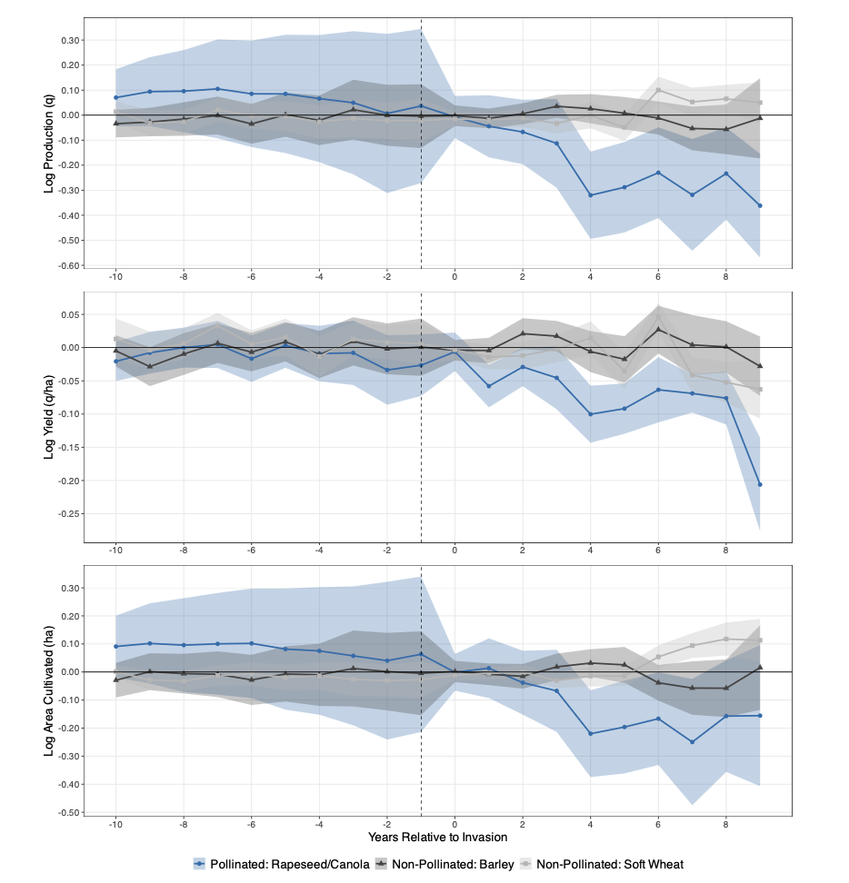
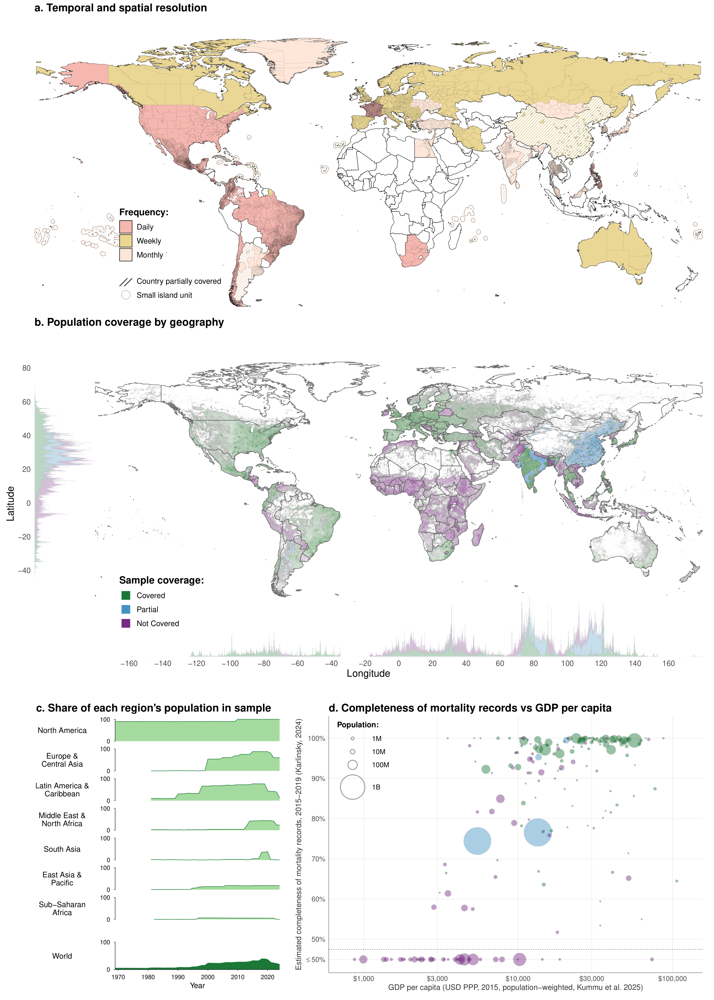

## Research Interests

My research focuses on identifying and quantifying the economic value of ecosystem services and understanding how economic activities impact ecological systems. I am particularly interested in designing policies that can better manage this bidirectional relationship.

## Working Papers

### Understanding and Addressing Temperature Impacts on Mortality

Marshall Burke, Andrew Wilson, Ziqian Xia, **Léon Beaufils**, Tumenkhusel Avirmed, Jonas Wallstein, Tina Bardot, Mariana Martins, Patrick Behrer, Christopher W. Callahan, Marissa Childs, June Choi, Karina French, Carlos F. Gould, Guojun He, Sam Heft-Neal, Renzhi Jing, Minghao Qiu, Lisa Rennels, and Emma Southworth

*Under review*

A large literature documents how ambient temperature affects human mortality. We compile longitudinal sub-national data from 115 countries and territories representing nearly 500M deaths, and use the data to revisit and synthesize key findings from this literature. We confirm that ambient temperature is among the largest external threats to human health, with heat and cold responsible for 3–15% of deaths across all countries in our sample, putting it among the top causes of death in many countries. In most contexts we consider, including low- and middle-income tropical countries, cold kills more than heat, though the temperature of minimum risk rises with age, making younger individuals generally more vulnerable to heat and older individuals more vulnerable to cold. We find evidence for adaptation to the local climate, with hotter places experiencing somewhat lower risk on hot days but often higher aggregate heat-related mortality due to more frequent exposure. Within countries, higher income is not associated with uniformly lower vulnerability to ambient temperature. Guided by these results, we systematically review the academic literature studying interventions that can moderate the impact of heat and cold on health, limiting our search to studies that resolve a plausibly causal relationship. Consolidating results across 52 studies, we find that many proposed and implemented interventions lack empirical support and do not target temperature exposures that generate the highest health burden. Further, some of the most beneficial interventions for reducing the health impacts of cold or heat have little explicit to do with the climate.

{.paper-figure .lightbox group="temp-mort" fig-alt="Three-panel figure: a world map of study coverage, regional temperature–mortality response curves, and a bar chart of the share of deaths attributable to heat and cold by country."}

### The Economic Cost of Pollinator Loss: Evidence from an Invasive Species

**Léon Beaufils**

*Working paper*

Insect pollinators are in global decline due to anthropogenic pressures, despite continued growth in the production of pollination-dependent crops. This divergence poses risks to agricultural productivity and food security, yet the economic value of pollination services remains poorly identified. As a result, policymakers face challenges in incorporating pollinators into cost-benefit analyses for conservation efforts and in addressing the negative externalities that contribute to their decline. This paper provides causal estimates of the effects of pollinator loss by exploiting quasi-exogenous variation in pollination supply from the staggered biological invasion of the Asian hornet (*Vespa velutina*) – a predator of insect pollinators – across France. Using a difference-in-differences design, I find that hornet invasion reduces managed beehive counts by 11.4%, oilseed rape yields by 5.2%, and average farmland prices by 4.3%. These results underscore the high economic value of insect pollinators for agriculture and illustrate how ecosystem health can shape economic outcomes.

::: {layout="[70.5,29.5]" layout-valign="bottom"}
{.paper-figure .lightbox group="pollinator" fig-alt="Two-panel figure: a map of France showing the year the Asian hornet first reached each département since its introduction in 2004, and a chart of years since invasion by département and year."}

{.paper-figure .lightbox group="pollinator" fig-alt="Three stacked event-study plots of log production, log yield, and log area cultivated relative to years since Asian hornet invasion, comparing pollinated rapeseed with non-pollinated barley and soft wheat; rapeseed declines after invasion while the other crops do not."}
:::

## Work in Progress

### GHOMP: Global Harmonized Open Mortality Panel

Andrew Wilson, **Léon Beaufils**, Tumenkhusel Avirmed, Jonas Wallstein, Tina Bardot, and Marshall Burke

Longitudinal, spatially-explicit data on societal outcomes are central to scientific and policy efforts to monitor well-being, understand how it changes, and design and evaluate policies to improve it. We collect, clean, and harmonize data on one key health outcome, mortality, generating GHOMP: the Global Harmonized Open Mortality Panel dataset. The current version of GHOMP represents geographically harmonized sub-annual longitudinal (panel) mortality counts for 16,833 small-geography units across 115 countries and territories. We construct mortality rates by assembling population data for each unit and period, and we validate data temporally and spatially against more aggregated available datasets. We release these data alongside harmonized geography files to facilitate merging with other spatially explicit data. GHOMP allows for the application of standard causal inference approaches to evaluate policies related to and drivers of short-run variation and long-run trends in mortality at a local level across a diverse set of global locations, accelerating efforts to protect and improve human health.

{.paper-figure .lightbox group="ghomp" fig-alt="Four-panel figure: a world map of the temporal resolution of mortality data (daily, weekly, monthly), a world map of population coverage, the share of each region's population in the sample over time, and completeness of mortality records versus GDP per capita by country."}
